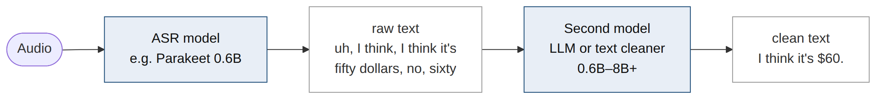
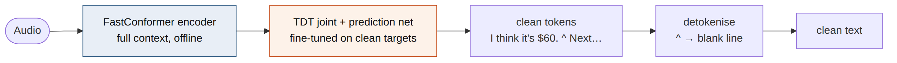
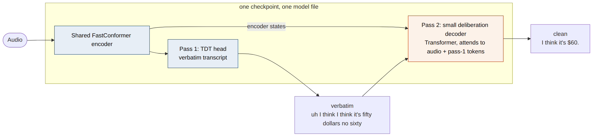
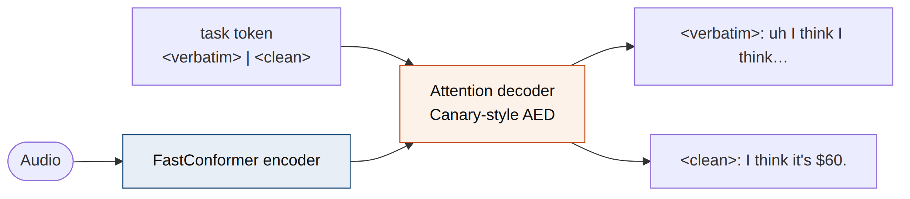

# The idea

Voice dictation today is a two-model job. An ASR model writes what was said, word for word, and a
second model (a regex layer, a small text model or an LLM) cleans it up: it removes fillers,
applies "scratch that", writes numbers as digits and adds paragraphs. The cleanup that matters to
nearly everyone is the same every time, yet it costs a second model, a second inference step and,
on a phone, a second download.

Proofed tests a simple question: **how much of that general-purpose cleanup can be baked into the
ASR model itself?** The base is an unmodified Parakeet TDT 0.6B v2. The fine-tune is trained only
on audio paired with the clean target, task by task, each task evaluated on its own. Domain
vocabulary (names, technical terms, code-switching) is deliberately excluded: it is a separate
layer that can be fine-tuned on top later.

{width=95%}

## Why integrate, and why not just use an audio LLM

| | ASR + LLM cleanup (today) | Audio-multimodal LLM | **Proofed** |
|------------------|------------------------|------------------------|------------------------|
| Core task | transcription, then text editing | everything (chat, reasoning, audio QA) | **transcription, written cleanly** |
| Models at inference | 2 | 1, large | **1, ~0.6B** |
| Size on device | ASR + 0.3–8 GB text model | several GB and up | **ASR only** |
| Latency | ASR plus a full LLM pass | slow autoregressive decode | **ASR decode, plus at most a small second head** |
| Hallucination risk | LLM can rewrite content | high, open-ended output | **low: output is constrained to what was said** |
| Instruction-following | prompt-driven, variable | prompt-driven, variable | **fixed: the same cleanup every time** |
| Sees the audio when cleaning | no (text only) | yes | **yes** |

The point of the last row: a text-only cleaner cannot hear a pause, a change of voice or a
whisper. A cleanup step inside the ASR model can use prosody to decide where a paragraph ends or
that a remark was aimed at someone else.

# Challenges identified

From the voice note and the phase 1 research (report in the repo, 125 sources):

1. **Nobody has done this on a transducer.** Disfluency removal end-to-end is published for CTC,
   attention and RNN-T models on Switchboard, and with a pretrained acoustic model it matched or
   beat ASR + cleanup (Bassi et al. 2023: 12.2% vs 13.1% WER). There is no Parakeet or TDT
   version, and nothing on dictation self-corrections, same-speaker asides or paragraphs.
2. **Some edits look ahead or reorder.** Deleting "Haifa" in "Haifa today, I mean Tiberias" is
   only decidable after hearing "I mean". "fifty dollars" → "$50" emits a symbol before the word
   it came from. A monotonic transducer may find these hard (§5).
3. **Paragraph breaks need a token Parakeet does not have.** The v2 tokenizer is a 1,024-piece
   SentencePiece BPE with `nmt_nfkc` normalisation, which turns `\n` into a space (§6).
4. **Catastrophic forgetting.** A narrow full fine-tune has been reported to move WER from 5.12% to
   51.08%; replay data or joint adapters held it at 5.79% (research §3.4).
5. **Data.** About 42 minutes of in-scope recordings exist today, none yet for self-corrections.
   Acted disfluency (read from a prompt) may not transfer to natural dictation: untested anywhere.
6. **Where the line is.** Only transformations that are right for every user every time belong in
   the model. Anything use-specific (email formatting, style) stays outside.

# The proposal

Fine-tune Parakeet TDT 0.6B v2 on (audio, clean text) pairs drawn from a fixed taxonomy of
post-processing tasks, with replay data to protect plain transcription, and score every task
separately: task success, WER on the words that should be kept, and regression on plain English
(LibriSpeech-PC). Start with the core tier, then add the ambitious and experimental tiers as
separate measured experiments, so that a task that cannot be learned at this scale is identified
rather than hidden in an average.

**Data:** own read-aloud recordings per task (the recorder app has a dedicated Proofed mode;
target about 4 hours for the first run), redistributable public corpora (DisfluencySpeech, AMI,
ICSI, LibriSpeech-PC for replay), and TTS synthesis for self-corrections, asides and the long tail
of numbers.

# The integrated post-processing

Each task is classed by what it does to the token sequence, because that decides which decoder can
learn it (§5). Full version: `docs/taxonomy.md`.

| Id | Task | Op | Said → written | Tier |
|----|------------------|----------|----------------------------------------------|-----------|
| A1 | Filled pauses | delete | "I, uh, think so" → "I think so" | core |
| A2 | Repetitions | delete | "the the report" → "the report" | core |
| A3 | False starts | delete | "And going to the — I'm going to the cinema" → "I'm going to the cinema" | core |
| A4 | Abandoned sentences | delete-ctx | "I think I had an idea — I want to go to the movies" → "I want to go to the movies" | core |
| B1 | Self-corrections | delete-ctx | "Haifa today. I mean Tiberias" → "Tiberias today" | ambitious |
| B2 | Editing commands | delete-ctx | "Jerusalem. Scratch that, Tel Aviv" → "Tel Aviv" | ambitious |
| C1 | Numbers, dates, units | rewrite | "twenty twenty-six" → "2026" | core |
| C2 | Money | reorder | "fifty dollars" → "$50" | core |
| D1 | Paragraph breaks | structure | (pause, topic shift) → blank line | ambitious |
| E1 | Asides to someone else | filter | "the docs are here — just leave it by the door — now" → "the docs are here now" | experimental |
| F1 | Whispered speech | robust | (whispered) → same text | robustness |

**Operation types:** *delete* drops a span in place; *delete-ctx* drops a span whose deletion
depends on later audio; *rewrite* changes the written form in order; *reorder* moves a token;
*structure* inserts layout; *filter* drops speech not meant for the transcript; *robust* changes
only the acoustic condition. Punctuation and casing are inherited from the base model and must
survive.

**Negative controls** sit inside each task's prompts: intentional repetition ("very, very good")
stays, and numbers that are names or idioms ("Formula One") stay words. Over-deletion is the
failure the evaluation watches.

# Architecture: one forward pass or two

The voice note asks whether one model can "encapsulate two passes, the first pure ASR, the second
post-processing". Four options, from least to most change to Parakeet:

## Option A: single pass, fine-tuned TDT

Keep the architecture. Fine-tune the prediction network and joint (and optionally the upper
encoder layers, or adapters) on clean targets. Deletion becomes "emit blank over the span";
rewriting is monotonic. The FastConformer encoder is offline and full-context, so the encoder
frame for "Haifa" already carries information about the "I mean" that follows.

{width=95%}

**For:** zero inference cost, zero architecture change, the existing NeMo recipe and every
existing export (ONNX, sherpa-onnx) still work. **Against:** the decoder still commits left to
right, so delete-ctx and reorder tasks depend on the encoder having learned to encode the decision
early; TDT duration prediction over long deleted spans is untested.

## Option B: two passes inside one checkpoint (deliberation)

Pass 1 is the existing TDT head, producing the verbatim transcript. Pass 2 is a small Transformer
decoder that attends to both the encoder states and the pass-1 tokens, and writes the clean text.
Both share one encoder, ship as one model file and run in one call. This is the Google two-pass
and deliberation line of work: LAS rescoring of RNN-T (Sainath et al. 2019, arXiv 1908.10992;
17–22% WER reduction, under 200 ms added latency) and deliberation (Hu et al., ICASSP 2020, arXiv
2003.07962; a further 12% relative over LAS rescoring).

{width=100%}

**For:** pass 2 sees the whole utterance, so look-ahead edits and reordering become ordinary
sequence-to-sequence work; pass 1 keeps an exact verbatim output for free (useful for evaluation
and for users who want it); the deliberation decoder can be small (tens of millions of
parameters). **Against:** new module and training code in NeMo, a second autoregressive decode,
and export work for on-device use.

## Option C: task-token attention decoder (Canary-style)

An attention encoder-decoder with a task token (`<verbatim>` or `<clean>`) prompting the decoder,
as Canary does for transcription and translation. One pass, any edit, but it changes the base
model family (a candidate is canary-180m-flash), and attention decoders hallucinate more than
transducers on long or noisy audio.

{width=95%}

## Option D: tag, then delete

The decoder emits verbatim text with tags around spans to drop (Futami et al.; Mendelev et al.
found tagging better than direct deletion), and a trivial rule removes them. It keeps a verbatim
record and makes deletions inspectable, but it does not help rewriting or reordering.

## Comparison and recommended path

| | A: single pass | B: two-pass, one checkpoint | C: task-token AED | D: tag-then-delete |
|-------------------|---------------|---------------|---------------|---------------|
| Architecture change | none | add a small decoder | different base | none (targets only) |
| Inference cost | 1× | 1× encoder + small decoder | 1× AED decode | 1× |
| delete | good | good | good | good |
| delete-ctx | uncertain | good | good | uncertain |
| reorder ($50) | uncertain | good | good | no help |
| Verbatim kept | no | yes | yes (other mode) | yes |
| On-device export | existing | new work | existing (Canary) | existing |

**Plan:** run A first, task by task, because it costs nothing at inference and answers the core
question directly. Add B only for the task families where A fails (expected: B1/B2 and C2). Run
C with canary-180m-flash as a control, so a failure of A can be attributed to the decoder type
rather than to the data.

# Paragraph breaks

Paragraphs matter to the project more than any other formatting task, and no ASR model was found
that emits them natively; AssemblyAI and Deepgram add them after recognition, on the API side.

**What Parakeet TDT 0.6B v2 offers:** no newline piece. A sweep of all 22 NVIDIA Parakeet,
Canary and Nemotron speech tokenizers (pulled from the `.nemo` archives, with `\n`, `\n\n`, `¶` and
U+2029 round-tripped) found that every one strips the newline. The only partial exception is
canary-qwen-2.5b, whose Qwen3 decoder has newline tokens, at 2.5B parameters.

| Route | How | For | Against |
|------------------|------------------------------------------|-------------------|-------------------|
| **1. Add a paragraph token to v2** (recommended) | Add `"\n"` (or a named para token) to the tokenizer, as NVIDIA did for `<EOU>`/`<EOB>` in parakeet_realtime_eou_120m-v1 (ids 1024–1025); warm-start the joint so the new row sits at 1024, blank moves to 1025, and the five TDT duration rows stay last | a real token; `\n\n` round-trips exactly (tested); all pretrained weights kept | NeMo's warm-start routine was written for plain RNN-T and needs adapting for TDT's row layout (read from code, not yet run) |
| **2. `^` sentinel** (control arm) | Train with ` ^ ` (id 918, one token) at paragraph boundaries; replace after decoding | no model change at all | borrows a real character; a hack |
| **3. v3 reserved token** (fallback) | parakeet-tdt-0.6b-v3 ships 30 unused reserved tokens (spltoken0–29) the model can already emit | no code change | leaves v2, which is better in English |

Avoid NeMo `change_vocabulary`: it reinitialises the decoder and joint and drops the TDT loss.
Whether the TDT duration head learns to emit a paragraph token cleanly at pauses is untested.
Full survey: `research/2026-10-24-phase-1-feasibility/notes/06-parakeet-newline-survey.md`.

# Data and plan

| Phase | What | Status |
|------|------------------------------------------------|---------------|
| 1 | Research: prior art, paragraph token, base models, feasibility, datasets | done 2026-10-24 |
| 2 | Data: record per task (≈4 h target), public corpora, TTS synthesis, publish the blend | in progress |
| 3 | Evaluation: per-task test sets, natural-dictation eval (40 spontaneous dictations) | planned |
| 4 | Prototype: Option A fine-tune on the core tier, then the other tiers | planned |
| 5 | Comparisons: Option B where A fails; Canary and Qwen3-ASR-0.6B arms | planned |

The training data so far is published as a public dataset,
`danielrosehill/Proofed-ASR-Cleanup-Training-Data` (CC-BY-4.0).

# Questions for the Parakeet team

1. **TDT and deletion.** Have you seen TDT models learn to drop long spans (fillers, false
   starts) cleanly? Does the duration head cope, or does it push towards skipping frames in ways
   that hurt the kept words?
2. **Look-ahead edits.** For self-corrections ("Haifa, I mean Tiberias"), would you expect the
   offline encoder to carry enough right context for a single-pass transducer, or is a second
   pass (Option B) the realistic route?
3. **A paragraph token in v2.** Is adding a token the way parakeet_realtime_eou_120m-v1 added
   `<EOU>`/`<EOB>` the right route for a TDT model, and is our row layout (new token at 1024, blank
   after it, durations last) correct? Is a newline or paragraph token planned for future models?
4. **Fine-tuning recipe.** For narrow tasks with a few hours of data: full fine-tune with
   replay, or adapters in the joint and decoder? Which layers would you unfreeze?
5. **Deliberation in NeMo.** Is there an existing NeMo component (or internal experience) for a
   second-pass decoder on top of a transducer that you would build on?
6. **Anything we have missed:** prior work at NVIDIA on clean or formatted output from Parakeet
   or Canary.

# Links

- Repository: https://github.com/danielrosehill/Proofed
- Project voice note (MP3, 24:40):
  https://github.com/danielrosehill/Proofed/blob/main/context/voice-notes/2026-10-24-proofed-brief/voice-note.mp3
- Phase 1 research report (PDF):
  https://github.com/danielrosehill/Proofed/blob/main/research/2026-10-24-phase-1-feasibility/Proofed-research-report.pdf
- Task taxonomy: https://github.com/danielrosehill/Proofed/blob/main/docs/taxonomy.md

Proofed is a non-commercial research project. Models and data will be published openly.
